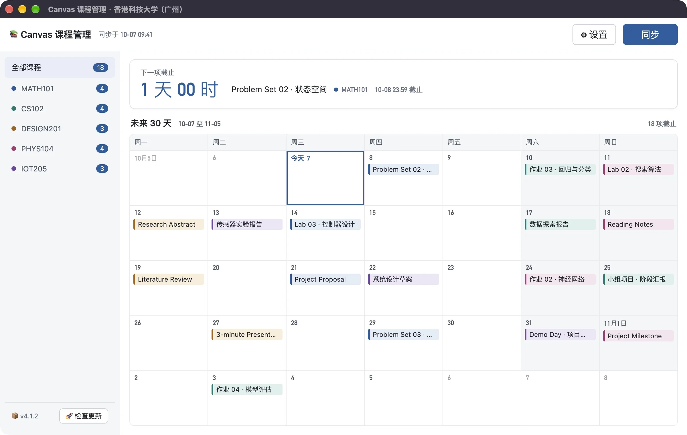

# Canvas Manager · Canvas 课程管理

把 Canvas 里的作业、公告和课件集中到桌面：一张 30 天截止日历、按课程整理的看板、批量下载课件。免费、开源，数据保存在本机。

A free, open-source desktop companion for Canvas. Deadlines on one calendar, course boards for assignments, announcements and files, and batch downloads. Your data stays on your computer.

[官网 Website](https://sixmonthfly.github.io/canvas-manager/) · [下载 Download](https://github.com/SixMonthFly/canvas-manager/releases/latest) · [使用说明](docs/guide.zh-CN.md) · [User guide](docs/guide.en.md)



## 工作原理 · How it works

应用通过你所在学校的 **Canvas API** 同步课程、作业、公告和课件；登录走学校自己的 Canvas 登录页，无需为本工具注册账号。**只适用于使用 Canvas 的学校**；学校未使用 Canvas，则无法使用本工具。

The app syncs through your university's **Canvas API** and signs in on your school's own Canvas login page. **It only works at universities that use Canvas.**

## 预设学校 · Preset universities

香港科技大学（广州）· 香港科技大学 · 香港城市大学 · 新加坡国立大学 · 新加坡社科大学 · 哈佛大学 · 牛津大学 · 墨尔本大学 · 奥克兰大学 · 金山大学 · 智利天主教大学

入口依据见 [docs/schools.md](docs/schools.md)。预设表示入口已按学校公开资料核实；各校的 SSO/MFA 与 API 权限可能不同。欢迎通过 Issue 或 PR 补充你的学校。

Endpoints are verified against each university's public documentation; SSO, MFA and API permissions can still vary. Issues and PRs adding your university are welcome.

## 功能 · Features

- 全部课程的下一项截止与 30 天月历 · Next deadline and a 30-day calendar across courses
- 每门课的作业、公告、课件看板 · Assignment, announcement and file boards per course
- 课件单个或批量下载 · Single or batch file downloads
- 截止提醒与定时同步 · Deadline reminders and scheduled sync
- 中英文界面、多校切换 · Chinese / English UI and school switching
- 可选插件：AI 助手（默认关闭）、Mac 系统小组件、外观皮肤 · Optional plugins: AI assistant (off by default), native Mac widgets, themes
- [MCP 服务](mcp-server/README.md)：让支持 MCP 的 AI 查询本机课程缓存 · An MCP server so compatible AI tools can query your local course cache

## 安装 · Install

从 [Releases](https://github.com/SixMonthFly/canvas-manager/releases/latest) 下载：

- **macOS 13+，Apple Silicon**：DMG。尚未经过 Apple 公证，首次打开可能需要在「系统设置 → 隐私与安全性」中选择「仍要打开」。
- **Windows 10/11 x64**：EXE 安装包，尚未签名，首次运行可能出现系统提示。

## 开发 · Development

需要 Node.js 24（见 `.node-version`）。

```bash
cd app
npm install
npm start        # 启动开发版 · run the app
npm test         # 单元测试 · unit tests
npm run dist:mac # 打包 Mac 版 · build the Mac DMG
```

```bash
cd mcp-server
npm install
npm test         # 编译并测试 · build and test
```

```bash
python3 website/serve.py   # 本地预览官网 · preview the website at http://127.0.0.1:4173
```

| 目录 · Path | 内容 · Contents |
| --- | --- |
| `app/` | Electron 客户端 · Electron client ([插件结构 · plugins](app/PLUGINS.md)) |
| `mcp-server/` | 独立 MCP 服务 · standalone MCP server |
| `website/` | 官网，推送 `main` 后由 GitHub Pages 发布 · website, deployed to GitHub Pages from `main` |
| `docs/` | 使用说明与学校资料 · user guides and school notes |

## 隐私 · Privacy

课程缓存、设置和下载文件只保存在本机。启用 AI 插件后，相关课程内容会发送给你自己配置的 AI 服务商。

Course caches, settings and downloads stay on your computer. If you enable the AI plugin, relevant course content is sent to the AI provider you configure.

## 许可 · License

[MIT](LICENSE)。第三方组件见 [THIRD-PARTY-NOTICES.md](THIRD-PARTY-NOTICES.md)。

本项目为独立工具，与 Instructure 或任何学校无关联。"Canvas" 是 Instructure, Inc. 的商标。

Independent project; not affiliated with Instructure or any university. "Canvas" is a trademark of Instructure, Inc.
